# 🛡️ Advanced Password Recovery & Security Assessment Lab: Hashcat (SANS GSEC Inspired)

[](https://www.kali.org/)
[](https://hashcat.net/hashcat/)
[](https://www.giac.org/certifications/security-essentials-gsec/)
[](https://github.com/Eng-Ghanem)

---

## 📌 Executive Summary

This repository documents an enterprise-grade password security, hash auditing, and recovery laboratory built inside a virtualized **Kali Linux** environment. Inspired by the **SANS GIAC Security Essentials (GSEC)** methodology, this project investigates real-world offline password recovery mechanisms, shell string handling, rule-based mutations that bypass wordlist exhaustion, Linux operating system troubleshooting, and the cryptographic strength of cryptocurrency wallet key derivation functions (KDF).

Rather than treating recovery tools as black boxes, this lab explores:
1. **Low-level hashing mechanics** and Unix shell history expansion mechanics.
2. **Hashcat optimization switches** (`Pure Kernels`, `Workload Tuning`, `Dictionary Caching`).
3. **Dynamic rule permutation** without inflating physical storage with oversized wordlists.
4. **Linux network debugging** (VMware NAT adapter configuration and ICMP routing).
5. **Cryptographic key stretching** (PBKDF2/SHA-512) and the computational defense differences between fast and slow hashing algorithms.

---

## 🏗️ Lab Architecture & System Specifications

| Component | Specification |
| :--- | :--- |
| **Operating System** | Kali Linux 2025.x (Rolling Release) |
| **Virtualization** | VMware Workstation / Player |
| **Virtual Processor** | 4 vCPUs allocated from Intel(R) Core(TM) i7-6700HQ CPU @ 2.60GHz |
| **Compute Engine** | OpenCL 3.0 PoCL 6.0+debian (`cpu-sandybridge`, 4MCU) |
| **Audit Engine** | Hashcat v6.2.6 |
| **Base Wordlist** | `rockyou.txt` (14,344,385 candidate passwords, ~133.4 MB uncompressed) |
| **Target Algorithms** | MD5 (Mode 0) & Bitcoin/Litecoin `wallet.dat` KDF (Mode 11300) |

```
                       ┌────────────────────────────────────────────────────────┐
                       │                   KALI LINUX LAB                       │
                       │                                                        │
                       │   ┌──────────────┐          ┌──────────────────────┐   │
                       │   │ rockyou.txt  │─────────▶│    Hashcat v6.2.6    │   │
                       │   │  (14.3M pws) │          │  (OpenCL PoCL CPU)   │   │
                       │   └──────────────┘          └──────────┬───────────┘   │
                       │                                        │               │
                       │            ┌───────────────────────────┼───────────┐   │
                       │            ▼                           ▼           ▼   │
                       │     [Phase 1: MD5]             [Phase 2: Rules]  [Phase 3: BTC]
                       │      Straight Attack            custom.rule       Mode 11300   │
                       │      (20.3 kH/s)                (1.37 MH/s)       (93-111 H/s) │
                       └────────────────────────────────────────────────────────┘
```

---

## 📑 Table of Contents
- [Phase 1: Environment Setup & Baseline Dictionary Attack](#-phase-1-environment-setup--baseline-dictionary-attack)
- [Phase 2: Shell Escaping & Rule-Based Attacks](#-phase-2-shell-escaping--rule-based-attacks)
- [Phase 3: Cryptocurrency Wallet Auditing & Real-World Troubleshooting](#-phase-3-cryptocurrency-wallet-auditing--real-world-troubleshooting)
- [📊 Performance & Cryptographic Benchmark Comparison](#-performance--cryptographic-benchmark-comparison)
- [🔒 Defensive Engineering & Remediation Strategies](#-defensive-engineering--remediation-strategies)
- [👤 Author & Acknowledgments](#-author--acknowledgments)

---

## 🛠️ Phase 1: Environment Setup & Baseline Dictionary Attack

### 1.1 Preparing the Wordlist
Kali Linux stores default dictionary collections under `/usr/share/wordlists/`. The standard `rockyou.txt` is distributed in a compressed Gzip format (`.gz`) to preserve drive capacity.

```bash
cd /usr/share/wordlists
sudo gzip -d /usr/share/wordlists/rockyou.txt.gz
```

#### Detailed Command Breakdown:
* `cd /usr/share/wordlists`: Changes working directory to the system wordlist repository.
* `sudo`: Elevates execution privileges to superuser (root), required because `/usr/share/` is a system-level write-protected directory.
* `gzip -d`: Decompresses (`-d` / `--decompress`) the archive, extracting the plaintext `rockyou.txt` file (~134 MB).

---

### 1.2 Workspace Creation & Baseline Hash Generation
To keep artifacts organized, a dedicated lab directory is created, and an MD5 digest for the weak baseline password `password123` is calculated.

```bash
mkdir ~/hashcat_lab && cd ~/hashcat_lab
echo -n "password123" | md5sum | awk '{print $1}' > simple_hashes.txt
```

#### Detailed Command Breakdown:
* `mkdir ~/hashcat_lab && cd ~/hashcat_lab`: Creates `hashcat_lab` inside the home folder and switches into it using the logical `&&` operator.
* `echo -n "password123"`:
  * **Critical Flag**: `-n` instructs the shell to omit the trailing newline character (`0x0a` / `\n`). Without `-n`, the calculated digest would include the newline, generating an unintended hash value.
* `|`: Standard Unix pipeline forwarding stdout to stdin.
* `md5sum`: Computes the 128-bit MD5 checksum.
* `awk '{print $1}'`: Parses output tokens and prints only the first column (the 32-character hexadecimal digest), discarding the default trailing dash (`-`).
* `> simple_hashes.txt`: Redirects output stream to a new file.

---

### 1.3 Executing the Baseline Dictionary Attack
```bash
hashcat -m 0 -a 0 simple_hashes.txt /usr/share/wordlists/rockyou.txt
```

#### Detailed Command Breakdown:
* `hashcat`: Launches the hash cracking engine.
* `-m 0`: Sets the target hash algorithm mode (`0` = **MD5**).
* `-a 0`: Sets the attack mode (`0` = **Straight / Dictionary Attack**).
* `simple_hashes.txt`: The input file containing the target hash.
* `/usr/share/wordlists/rockyou.txt`: The wordlist file to read candidates from.

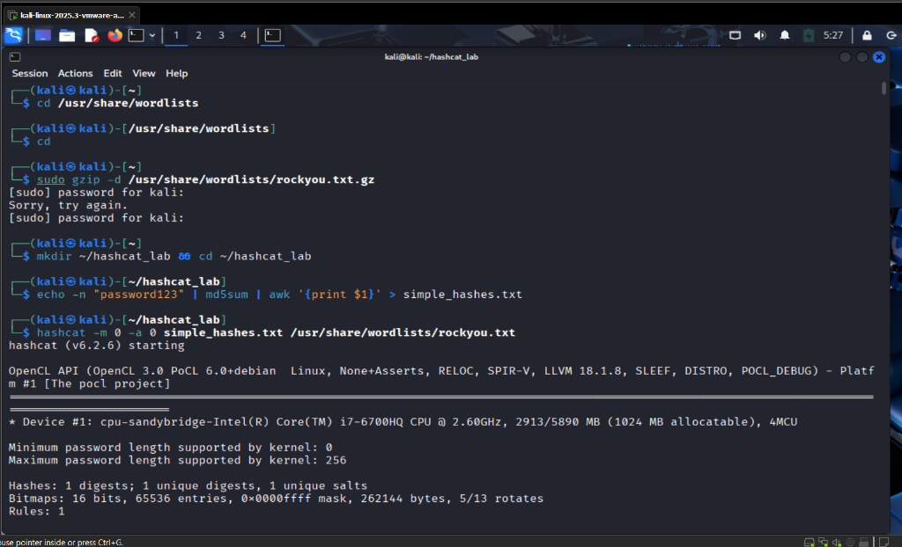
*Figure 1.1: Decompressing rockyou.txt, generating simple_hashes.txt, and starting Hashcat.*

---

### 1.4 Attack Execution & Verification
Hashcat automatically applies internal optimizations (`Zero-Byte`, `Early-Skip`, `Not-Salted`, `Raw-Hash`) and builds OpenCL kernels for the host CPU.

```
482c811da5d5b4bc6d497ffa98491e38:password123

Session..........: hashcat
Status...........: Cracked
Hash.Mode........: 0 (MD5)
Hash.Target......: 482c811da5d5b4bc6d497ffa98491e38
Time.Started.....: Thu Oct 8 16:05:00 2026 (0 secs)
```

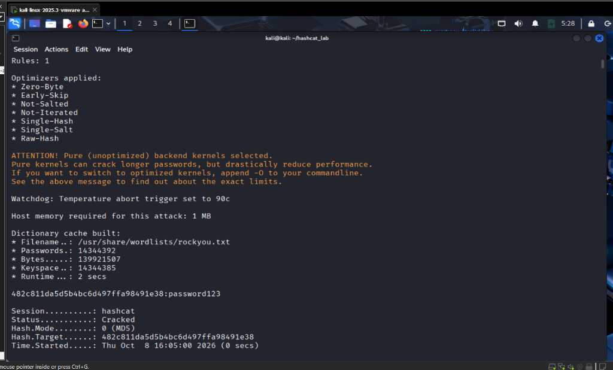
*Figure 1.2: Instant recovery of password123 with Status: Cracked.*

---

### 1.5 Performance Metrics
Because MD5 is a non-salted, single-round digest and the candidate string was located near the top of `rockyou.txt`, recovery completed in **0 seconds** at **20,339 H/s**:

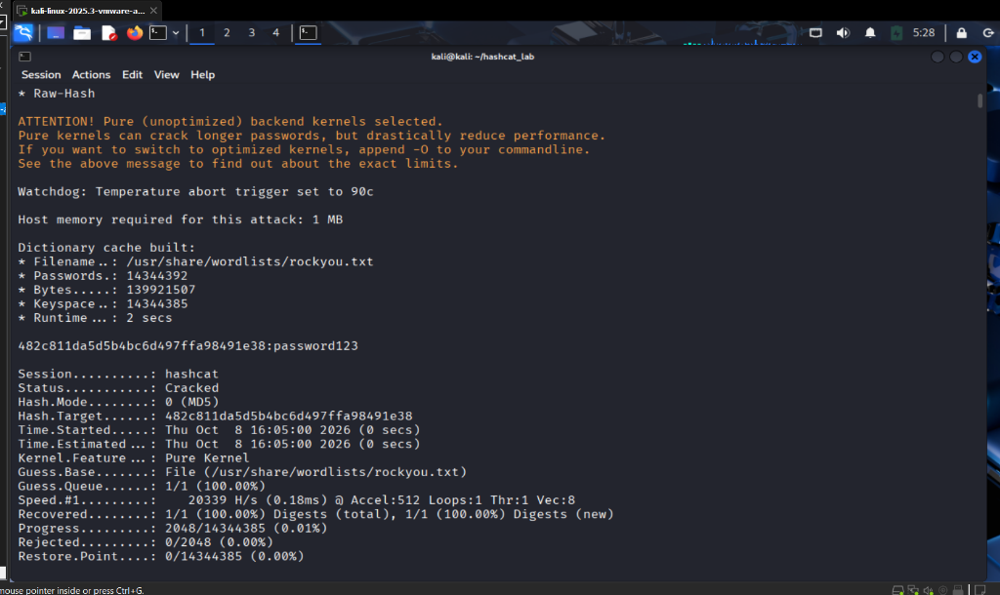
*Figure 1.3: CPU execution statistics and 100% digest recovery.*

---

## 🛡️ Phase 2: Shell Escaping & Rule-Based Attacks

### 2.1 The Shell Escaping Bug (Zsh History Expansion)
When attempting to generate a digest for a complex password (`password123!@#`), the command terminated unexpectedly:

```bash
echo -n "password123!@#" | md5sum | awk '{print $1}' > hard_hash.txt
zsh: event not found: @#
```

#### Root Cause Analysis:
In modern Kali Linux distributions running the **Zsh** shell, the exclamation mark `!` is an active metacharacter used for **History Expansion** (such as `!!` to recall the previous command, or `!n` to recall history event `n`). Inside double quotes (`"..."`), Zsh attempts to evaluate `!@#` as a history event and fails.

#### Remediation:
Wrap the input string with single quotes (`'...'`) to enforce literal string parsing:

```bash
echo -n 'password123!@#' | md5sum | awk '{print $1}' > hard_hash.txt
```

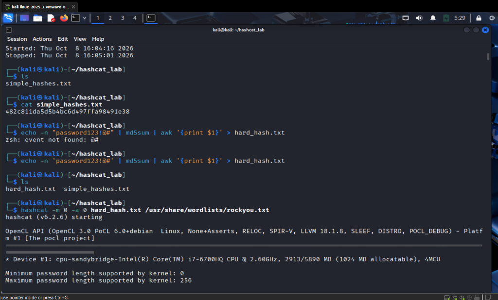
*Figure 2.1: Resolving Zsh history expansion failure using single-quote escaping.*

---

### 2.2 The Dictionary Exhaustion Problem
Running a standard dictionary attack against `hard_hash.txt` results in failure:

```bash
hashcat -m 0 -a 0 hard_hash.txt /usr/share/wordlists/rockyou.txt
```

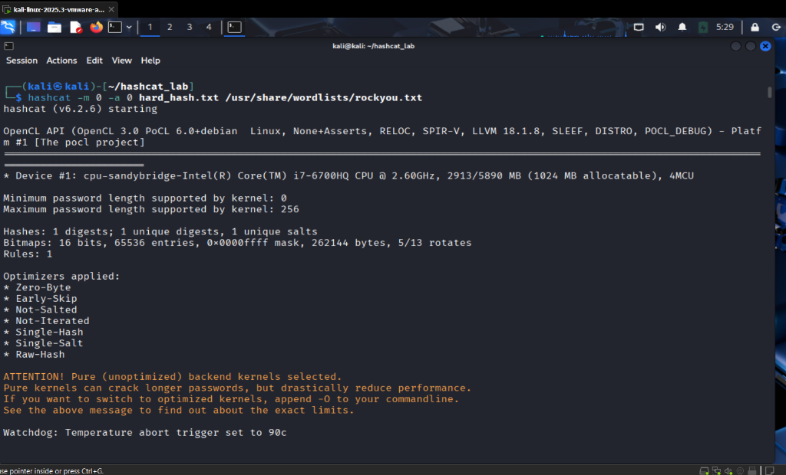
*Figure 2.2: Launching standard dictionary attack against the complex MD5 hash.*

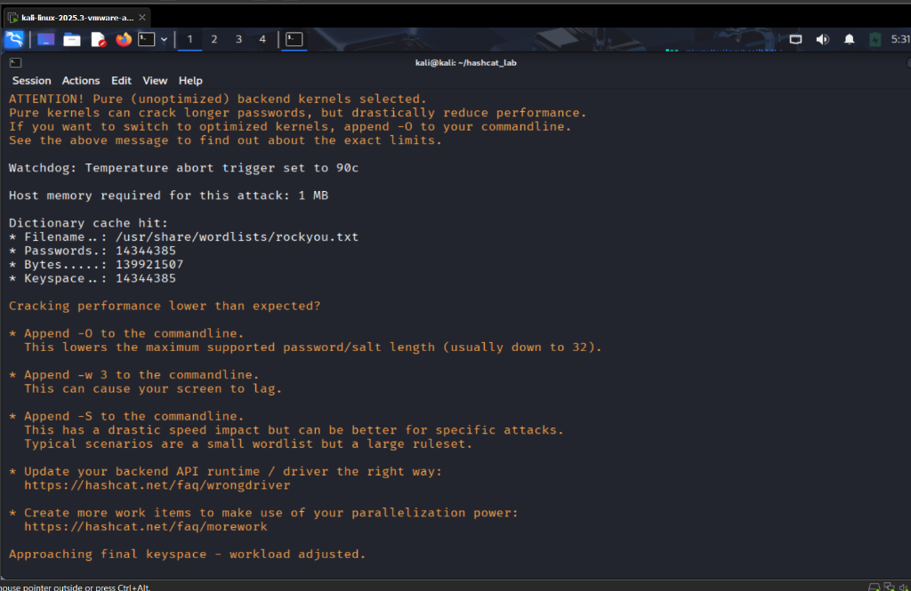
*Figure 2.3: Hashcat loading dictionary cache and approaching keyspace completion.*

#### Attack Outcome: `Exhausted`
Hashcat evaluated all **14,344,385** candidate passwords in 11 seconds at an average speed of **1,562.8 kH/s**, returning `Status: Exhausted`.

```
Session..........: hashcat
Status...........: Exhausted
Hash.Target......: e6c9268f2c8a2bd00e7ad265e69f8431
Recovered........: 0/1 (0.00%) Digests (total)
Progress.........: 14344385/14344385 (100.00%)
```

#### Why it Failed:
Standard wordlists reflect historical database breaches. When users modify standard roots by appending special characters (`!@#`), pure dictionary attacks will fail unless that exact combination already exists inside the file.

---

### 2.3 Crafting Custom Mutation Rules
Generating a new physical wordlist with appended characters would consume hundreds of megabytes of redundant disk space. Hashcat solves this via **Rule-Based Attacks**, altering candidates in memory on-the-fly.

A custom rule file `custom.rule` was created:

```bash
echo '$! $@ $#' > custom.rule
```

#### Rule Syntax Breakdown:
* `$c`: Appends character `c` to the end of the candidate word.
* `$!`: Appends exclamation mark `!`.
* `$@`: Appends at-symbol `@`.
* `$#`: Appends hash-symbol `#`.
* Applied sequentially, every word in `rockyou.txt` (e.g., `password123`) is dynamically transformed into `password123!@#` at runtime.

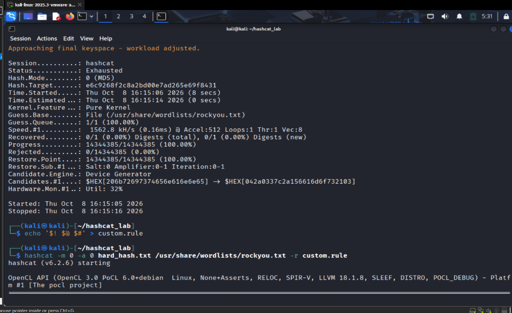
*Figure 2.4: Observation of Status: Exhausted, creation of custom.rule, and re-launching Hashcat.*

---

### 2.4 Successful Rule-Based Attack Execution
The attack was executed with the `-r` parameter:

```bash
hashcat -m 0 -a 0 hard_hash.txt /usr/share/wordlists/rockyou.txt -r custom.rule
```

* `-r custom.rule`: Routes all incoming candidate words through the rule parser before computing their MD5 digest.

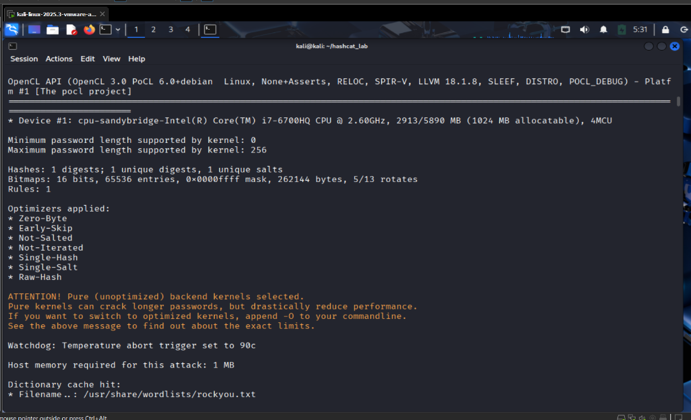
*Figure 2.5: Initializing OpenCL backend for rule-transformed execution.*

#### Result: Immediate Recovery
```
e6c9268f2c8a2bd00e7ad265e69f8431:password123!@#

Session..........: hashcat
Status...........: Cracked
Hash.Mode........: 0 (MD5)
Guess.Mod........: Rules (custom.rule)
Speed.#1.........: 1373.3 kH/s
Recovered........: 1/1 (100.00%) Digests
Candidates.#1....: 123456!@# -> lovers1!@#
```

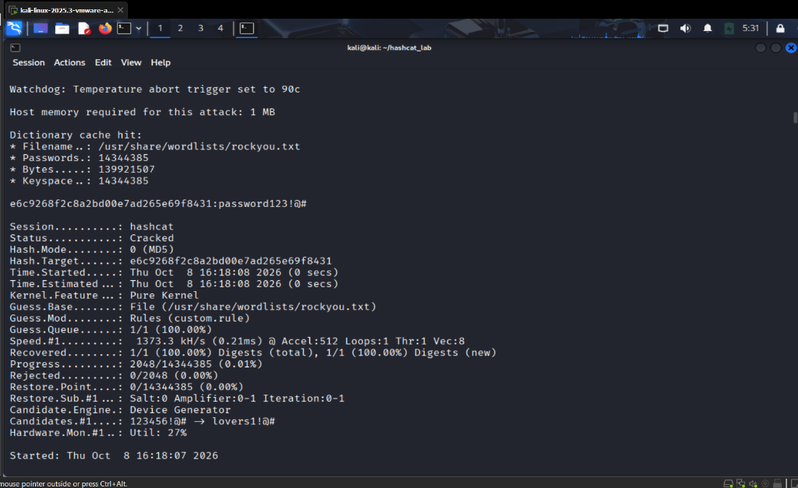
*Figure 2.6: Successful recovery of the complex password using dynamic rule evaluation.*

---

## 💰 Phase 3: Cryptocurrency Wallet Auditing & Real-World Troubleshooting

This phase audited the cryptographic resistance of a legacy Bitcoin Core wallet (`wallet.dat`) encrypted with heavy key derivation functions.

### 3.1 Troubleshooting 1: Missing Python Berkeley DB Library
Extracting hashes from `wallet.dat` requires `bitcoin2john` (part of the John the Ripper suite). Running the extraction initially generated an error:

```bash
bitcoin2john wallet.dat > btc_extracted.txt
Error: This script needs bsddb3 to be installed!
```

* **Root Cause**: Bitcoin `wallet.dat` files are structured as **Berkeley DB (Btree)** databases. The script requires Python's `bsddb3` module to parse the master key blocks.

To resolve this dependency:
```bash
sudo apt update && sudo apt install python3-bsddb3
```

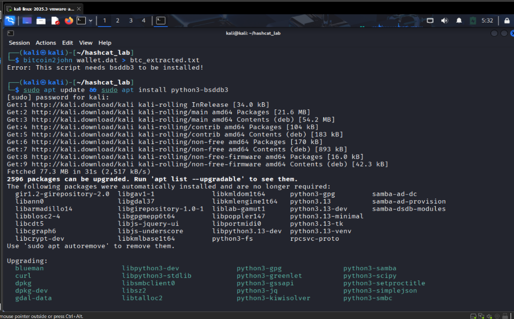
*Figure 3.1: Identification of missing bsddb3 dependency and starting apt install.*

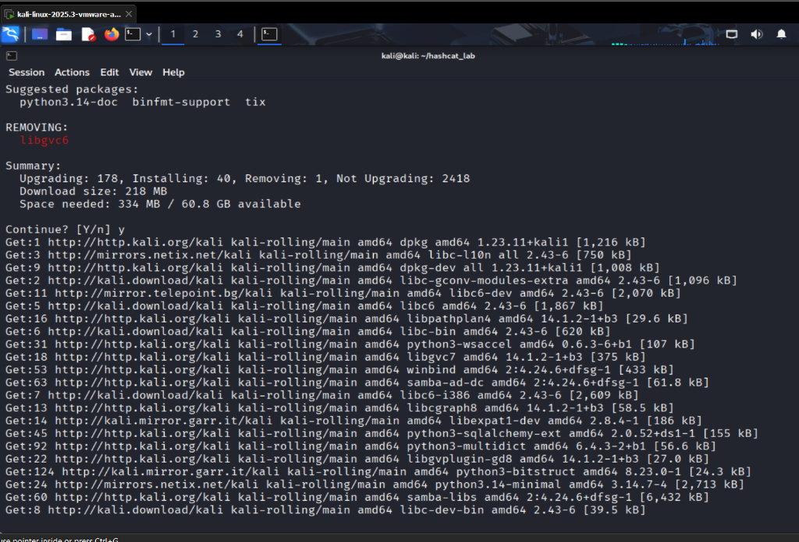
*Figure 3.2: Confirming installation of package updates and Python dependencies.*

---

### 3.2 Troubleshooting 2: Network Unreachable in Virtual Machine
During the package download, the APT manager threw multiple connection errors:

```
Error: Failed to fetch http://mirror1.sox.rs/kali/pool/main/...
Cannot initiate the connection to mirror1.sox.rs:80 - connect (101: Network is unreachable)
Error: Unable to fetch some archives, maybe run apt update or try with --fix-missing?
```

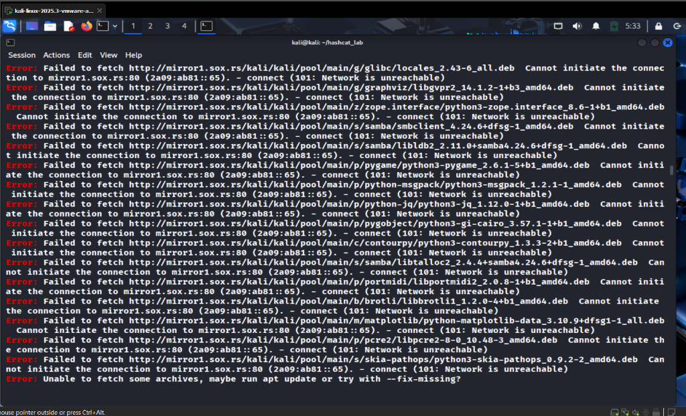
*Figure 3.3: Network unreachable failures in the virtual environment.*

#### Diagnostic & Remediation Workflow:
1. **Network Adapter Check**: The virtual machine's network adapter in VMware was in a detached state.
2. **Reconfiguration**: Switched the virtual adapter to **NAT (Network Address Translation)** mode, binding guest traffic to the host operating system's Internet connection.
3. **Connectivity Verification**: Tested ICMP routing against Google:
   ```bash
   ping -c 4 google.com
   ```
   * Packets were transmitted and received successfully, validating DNS and IP routing.
4. **Resuming Package Installation**:
   ```bash
   sudo apt update && sudo apt install python3-bsddb3
   ```

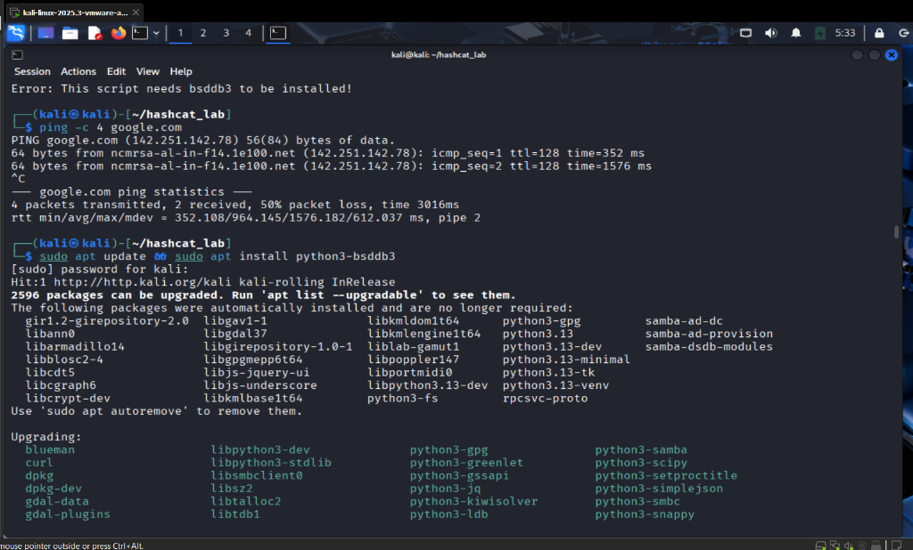
*Figure 3.4: Verifying network via ping and updating package repositories.*

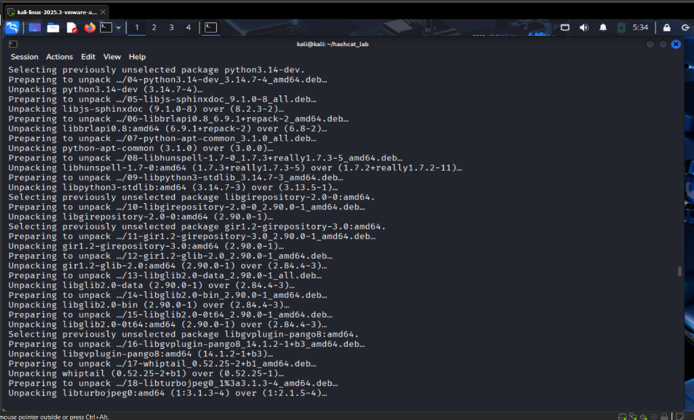
*Figure 3.5: Finalizing the installation of python3-bsddb3.*

---

### 3.3 Troubleshooting 3: Physical Wallet File Absence & Mock Hash Generation
Re-running `bitcoin2john wallet.dat` produced:

```
ERROR:root:(2, 'No such file or directory')
ERROR:root:Couldn't open wallet.dat/main. Try quitting Bitcoin and running this again.
```

To evaluate Hashcat's cryptographic performance without exposing live private keys, a standardized mock Bitcoin hash was generated:

```bash
echo '$bitcoin$64$d0822a15f02bc3c726a27694fba9009623dc5872cc4a34b6b6131c9be4cb0e7c$16$7639598256338570$71334$2$00$2$00' > btc_hash.txt
```

#### Anatomy of a Bitcoin Hashcat Hash:
* `$bitcoin$`: Algorithm identifier.
* `64$`: Length of the encrypted master key in bytes.
* `d082...0e7c`: The encrypted master key payload.
* `16$`: Length of the cryptographic salt.
* `7639598256338570`: Salt value.
* `71334$`: **Key Derivation Rounds (Iterations)**. This parameter enforces computational hardness.

---

### 3.4 Executing Hashcat Mode 11300 (Bitcoin/Litecoin wallet.dat)
```bash
hashcat -m 11300 -a 0 btc_hash.txt /usr/share/wordlists/rockyou.txt
```

* `-m 11300`: Hashcat algorithm mode for **Bitcoin/Litecoin wallet.dat**.

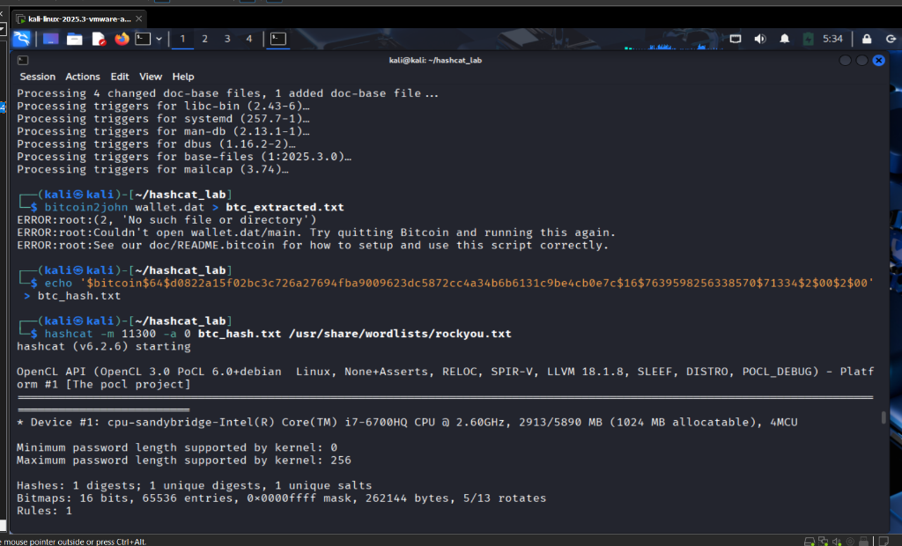
*Figure 3.6: Generation of btc_hash.txt and launch of Mode 11300 attack.*

Hashcat detected the heavy KDF workload, applying `Slow-Hash-SIMD-LOOP` optimizations and setting thermal safeguards (`Watchdog: Temperature abort trigger set to 90c`):

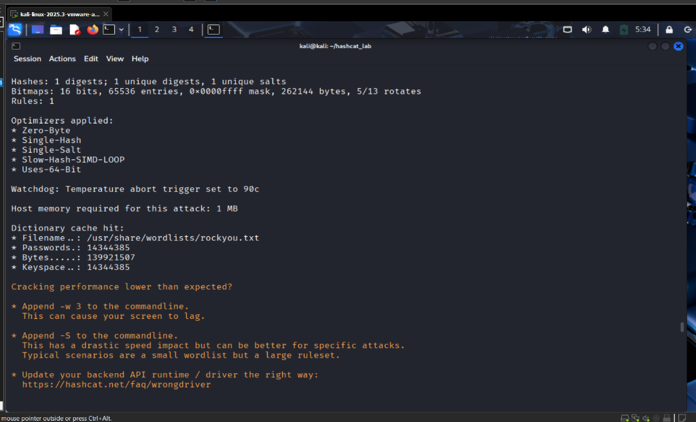
*Figure 3.7: Slow-Hash-SIMD-LOOP optimization parameters and 90°C thermal threshold.*

---

### 3.5 Performance Analysis: The Defense of Key Stretching
Immediately upon starting, Hashcat's hash rate dropped significantly:

```
Session..........: hashcat
Status...........: Running
Hash.Mode........: 11300 (Bitcoin/Litecoin wallet.dat)
Speed.#1.........: 93 H/s (27.18ms)
Time.Started.....: Thu Oct 8 17:02:37 2026 (2 mins, 50 secs)
Time.Estimated...: Sat Oct 10 11:44:07 2026 (1 day, 18 hours)
Progress.........: 15488/14344385 (0.11%)
```

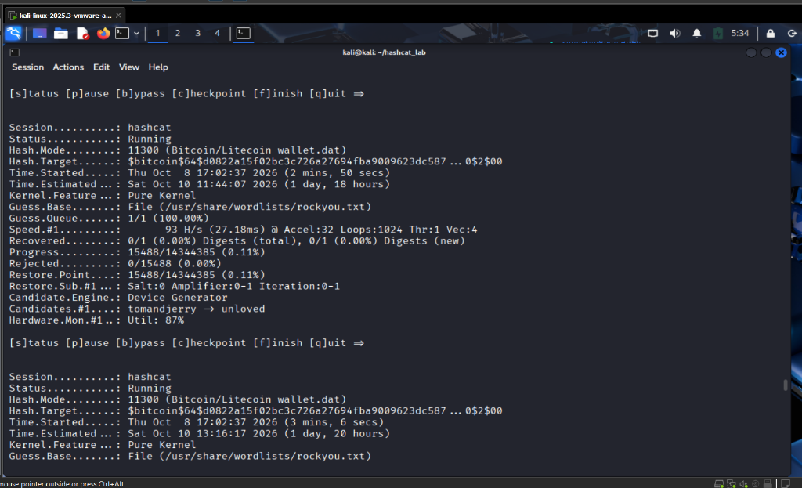
*Figure 3.8: Mode 11300 throughput throttled to ~93 H/s with an initial ETA of ~1 day, 18 hours.*

#### Extended Execution & Thermal Load:
After running for **21 minutes and 44 seconds**, only **1.00%** of the keyspace had been evaluated:
* **Speed**: Remained between **93 H/s** and **111 H/s**.
* **Estimated Completion Time**: **1 day, 11 hours** (Estimated finish: *Sat Oct 10 04:55:54 2026*).
* **Hardware Monitor**: CPU Utilization stayed elevated at **86% - 89%**.

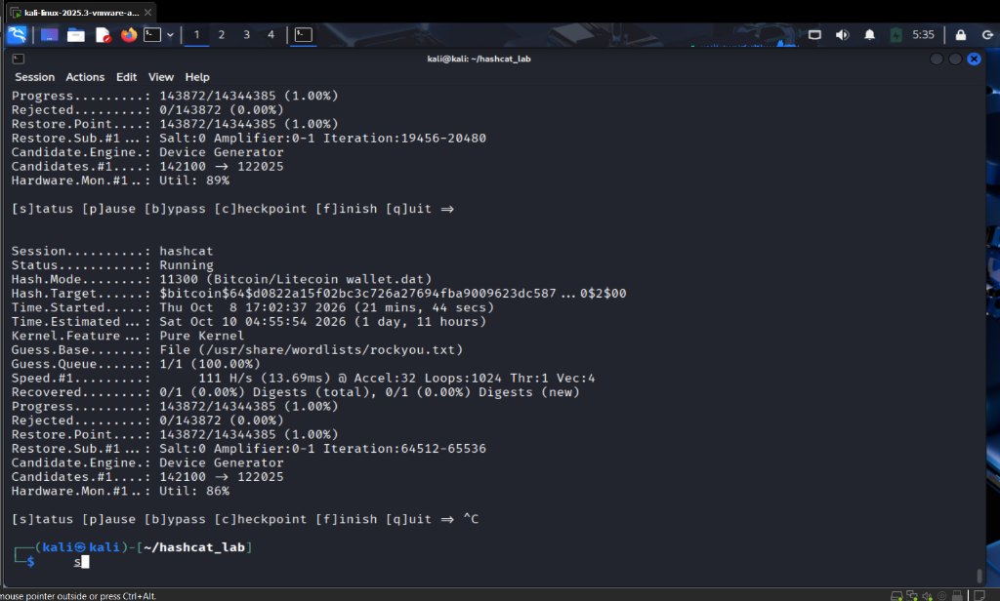
*Figure 3.9: Controlled abort (^C) after verifying proof of operation and thermal load.*

#### Controlled Session Abort (`Ctrl + C`):
In an operational security audit or educational lab, once the throughput baseline and time-to-completion feasibility are verified, letting an intensive KDF attack run continuously on a virtualized CPU risks hardware degradation without providing additional educational value. The session was safely aborted via `^C` (SIGINT).

---

## 📊 Performance & Cryptographic Benchmark Comparison

| Metric | Phase 1 (MD5 - Mode 0) | Phase 2 (MD5 + Rules) | Phase 3 (Bitcoin - Mode 11300) |
| :--- | :--- | :--- | :--- |
| **Algorithm Family** | Un-salted Message Digest | Mutated Message Digest | PBKDF2 / SHA-512 (Key Stretching) |
| **Hashcat Mode** | `-m 0` | `-m 0 -r custom.rule` | `-m 11300` |
| **Throughput Speed** | **20,339 H/s** | **1,373.3 kH/s** (~1.37 MH/s) | **93 – 111 H/s** |
| **Performance Multiplier**| Baseline | ~67x (Optimized Kernels) | **~15,000x Slower than MD5** |
| **Keyspace Completion** | 0.01% (Cracked instantly) | 0.01% (Cracked instantly) | 1.00% in 21 minutes (~36+ hours total) |
| **Hardware Bottleneck** | Memory bus / CPU threads | Kernel caching | Math iterations (71,334 rounds per pass) |

### Key Theoretical Takeaways:
1. **Fast Hashes (MD5, SHA-1, SHA-256)**: Designed for data integrity, not password storage. They execute with minimal CPU cycles, allowing attackers to test millions or billions of candidates per second.
2. **Slow Hashes / Key Stretching (PBKDF2, Argon2, bcrypt, scrypt)**: Intentionally consume CPU and memory by executing thousands of rounds per attempt. An attacker attempting 14 million passwords against Bitcoin's KDF on a standard CPU faces a **36+ hour barrier**, compared to less than **10 seconds** against MD5.
3. **Virtualization vs. Dedicated ASICs/GPUs**: While CPUs process sequential instructions well, graphics processors (GPUs) feature thousands of smaller stream cores designed for parallel math, explaining why high-performance cracking rigs utilize dedicated GPUs.

---

## 🔒 Defensive Engineering & Remediation Strategies

As documented in SANS GSEC standards, understanding password recovery mechanics directly dictates defensive password policy architectures:

### 1. Reject Legacy Fast Hashing Algorithms
* Never store authentication credentials using MD5, SHA-1, or raw SHA-256.
* Enforce **memory-hard** and **computationally intensive** algorithms:
  * **Argon2id** (Winner of the Password Hashing Competition - recommended).
  * **bcrypt** (Work factor >= 12).
  * **PBKDF2** (With at least 600,000 iterations for SHA-256 per OWASP recommendations).

### 2. Guard Against Rule-Based Mutation Attacks
* Simple complexity rules (e.g., "Must contain 1 uppercase letter and 1 special character") do **not** stop modern attackers; they simply make automated rule-generation predictable (e.g., capitalizing the first letter and appending `!@#` at the end).
* Prioritize **Passphrase Length** over predictable complexity:
  * A 16-character passphrase composed of 4 random dictionary words (e.g., `correct-horse-battery-staple`) exponentially expands the keyspace beyond the reach of standard rule engines.

### 3. Implement Cryptographic Salting & Peppering
* Ensure a cryptographically secure pseudo-random salt (minimum 16 bytes) is generated uniquely for every user.
* Store a system-wide secret key (**Pepper**) in a dedicated Hardware Security Module (HSM) or secret manager to prevent offline attacks even if the database is leaked.

---

## 👤 Author & Acknowledgments

* **Lead Researcher**: [Eng-Ghanem](https://github.com/Eng-Ghanem)
* **Lab Environment**: Kali Linux on VMware Workstation
* **Academic Reference**: Inspired by SANS GIAC Security Essentials (GSEC) principles.

---

### ⚠️ Disclaimer
*This laboratory documentation and its contents are created strictly for educational purposes, defensive security auditing, and authorized system assessment. Unauthorized access or password cracking against systems without explicit, written permission is illegal and strictly prohibited.*
